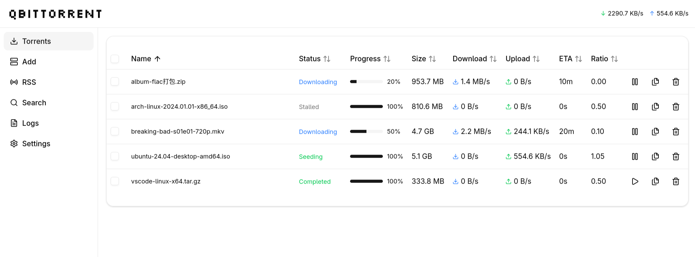

# qbitwebber

A minimalist, mobile-friendly frontend for qbittorrent web UI.

I built the initial version of this on a weekend because I felt the other options were a bit cluttered.

Built with React, Vite, and TypeScript.



## Features

- Manage Torrents
- RSS Feed
- Search
- Settings (Simplified Compared to Offical Web UI)
- Mobile-friendly responsive design
- Light & Dark Mode

## Installation

Download the zip of this repository (or clone it) and then configure qbittorrent custom web UI path to the release directory.

The `release` directory must contain the `public` folder (with `index.html` directly inside it). Point qBittorrent to the `release` directory itself, not to `release/public`.

Works with qBittorrent 5.x (including 5.2+) and when qBittorrent is served from a sub-path behind a reverse proxy (e.g. `https://example.com/qbittorrent/`) – open the URL with the trailing slash.

Your password is never stored by the web UI; the session is kept via qBittorrent's own HttpOnly session cookie.

## Downloading Files

qBittorrent's Web API cannot serve the content of a torrent, so downloads go through a separate HTTP file server that exposes your download directory (nginx, or the file area many seedboxes provide). Under Settings > General > File Downloads, enter:

- **File server URL**: where that directory is served, e.g. `https://example.com/files/`
- **Directory this URL points to**: the same directory's path on the server, e.g. `/home/user/downloads`

A download button then appears next to each completed file in the torrent dialog's Details and Content tabs. Downloads use the file server's own login, if it has one. These settings are saved per browser.

## Development

During development the Vite dev server proxies API requests under `/api` to the qBittorrent backend.

By default the proxy target is set in `vite.config.ts` at `server.proxy['/api'].target`.

Change that value to the full URL (including protocol and port) where your qBittorrent backend is running. Examples:

- Default local qBittorrent: `http://localhost:8080`
- Remote machine on LAN: `http://192.168.1.100:8080`


To run in dev mode:

```bash
npm install
npm run dev
```

## Demo Mode

Run without a backend for demonstration purposes:

```bash
npm run demo
npm run demo:build
```

## Release Build

```bash
npm run release
```

## Disclamer
 
To keep this from getting too cluttered it is likely missing things.

I may or maynot maintain this. 

Also you should only ever use this to download linux distros and nothing else.

## Contributions

Please feel free to open issues or submit pull requests. I will look at them when I have the time.
